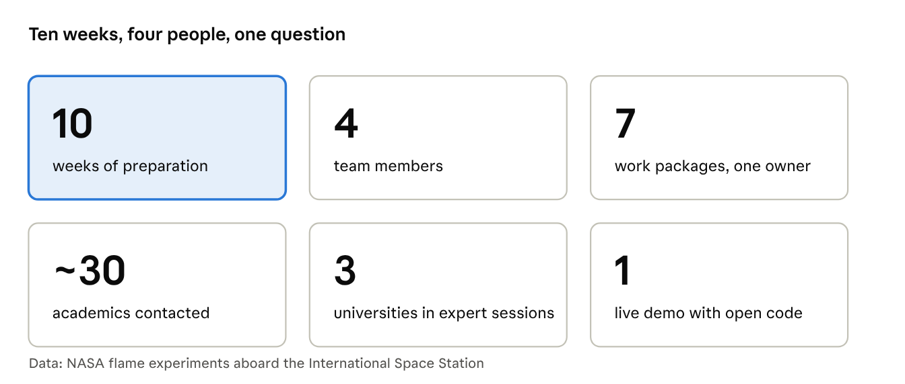
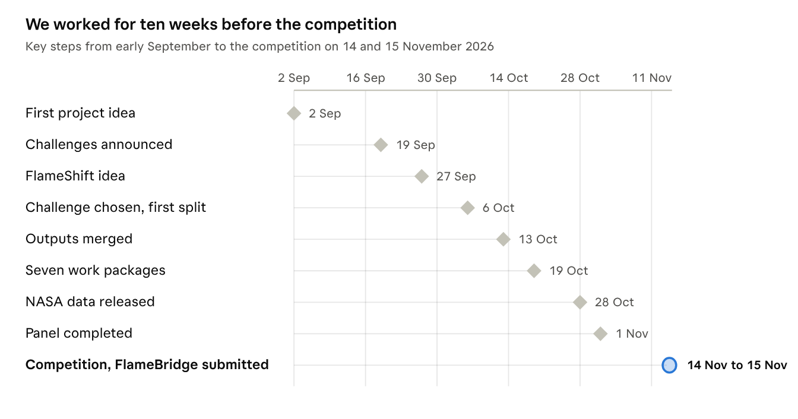

# Our road to NASA Space Apps 2026

**Can fire knowledge learned on Earth be trusted in space?** We spent ten weeks preparing to
answer that question with NASA's own flame experiments flown aboard the International Space
Station.

Without gravity, hot gas does not rise, so a flame in orbit spreads and breathes differently than
on the ground. Fire safety rules and tests are built on Earth. FlameBridge connects NASA's
measured results to new conditions and shows where the measured evidence ends.

This page is about how we got there. What the project does is in the [README](README.md), and the
science behind it is in [SCIENCE.md](SCIENCE.md).

## At a glance

## Our journey

We did not start with fire. Our first idea in early September was a different space science
project. When NASA announced the 2026 challenges, we chose "Flame in Freefall" because it asked a
real open question, and we rebuilt our plan around it. The idea was first called FlameShift and
became FlameBridge. From then on the team met regularly, split the work into seven packages with
clear owners, and brought in expert advice as the work matured, well ahead of the competition.

Before the competition we prepared the method, the literature and a first panel. The application
in this repository was then built in one continuous 24-hour run at the competition
([AGENTS.md](AGENTS.md)), on the data NASA released for the challenge.

## How we worked

We treated FlameBridge as a piece of science, not only as an app. Three principles guided the
work, and each one can be checked in this repository.

1. **Real data only.** Every value comes from NASA's archived space station flame experiments or
   from a documented calculation. A value that cannot be read is shown as missing, never guessed
   ([DATA_SOURCES.md](docs/DATA_SOURCES.md)).
2. **Limits stated openly.** The project lists what it cannot claim next to what it shows
   ([LIMITATIONS.md](LIMITATIONS.md)).
3. **Every change checked.** Automated tests and repeated critical review rounds guarded the code
   and the documents ([METHODS_AND_VALIDATION.md](docs/METHODS_AND_VALIDATION.md)).

## Guided by experts

We did not work in isolation. We contacted about 30 academics and researchers in Türkiye and
abroad, and held working sessions with experts in the fields the project touches.

| Field | Institution | What we asked |
|---|---|---|
| Combustion physics | Massachusetts Institute of Technology (MIT) | Whether our reading of the combustion physics was sound |
| Image processing | Gebze Technical University | How to measure a flame in the footage |
| Uncertainty quantification | Istanbul Technical University | How to state uncertainty honestly |

Our team advisors followed the work from the first idea to the competition, including a physics
and astronomy advisor who gave us the technical framework we started from.

### How we asked for advice

We reached most of these researchers by email, choosing people whose work matched one of our open
questions. We explained the project in plain terms and asked for their view or a short meeting.

- **Mid October.** Our first round of emails went to eight academics at four Turkish
  universities, asking for feedback on our method.
- **16 October.** A working session with a space engineer. The topics raised there became our
  next literature review.
- **18 to 19 October.** We widened the circle to researchers in Türkiye and abroad, graduate
  researchers included. The list grew to about 30 people, and we asked several of them for short
  meetings.
- **29 October.** A working session on uncertainty quantification with Istanbul Technical
  University.
- **2 November.** A working session with our combustion advisor at MIT.
- **Until 9 November.** An expert we stayed in touch with by email answered follow-up questions
  as gaps appeared in the work.
- **13 November.** Our combustion advisor at MIT answered our written questions.

### What the advice changed

- **Claims about real cabins.** An advisor pointed out that the size of the combustion chamber
  affects what is measured. FlameBridge states that it is not a simulator, a design tool or a
  safety certification.
- **Reading the gas data.** An expert pointed out that carbon monoxide and carbon dioxide
  readings do not explain the reaction kinetics on their own. FlameBridge shows these readings as
  NASA recorded them and adds no kinetic interpretation.
- **Measuring the flame.** An expert told us that pretrained models transfer poorly to flame
  images. In the submitted project the flame is measured with classical image processing, not
  with a learned model.

Some of the methods discussed in these sessions are not part of the submitted build. What the
build contains, and what it does not, is listed in [LIMITATIONS.md](LIMITATIONS.md).

## What we delivered

FlameBridge was submitted at the competition in Eskişehir on 14 and 15 November 2026. It connects
each NASA test to its measured conditions, its original source cells and its footage, and makes
explicit where the measured evidence ends and a new test would be needed.

- **Live demo:** [nasa-space-apps-2026-seven.vercel.app](https://nasa-space-apps-2026-seven.vercel.app)
- **Open code:** this repository
- **For judges:** [JUDGES.md](JUDGES.md) maps the judging criteria to the evidence

## What comes next

FlameBridge does not end with the hackathon. We plan to turn the work into a conference abstract
and a research paper, and we have written to candidate academic leads in Türkiye to carry it
forward.
