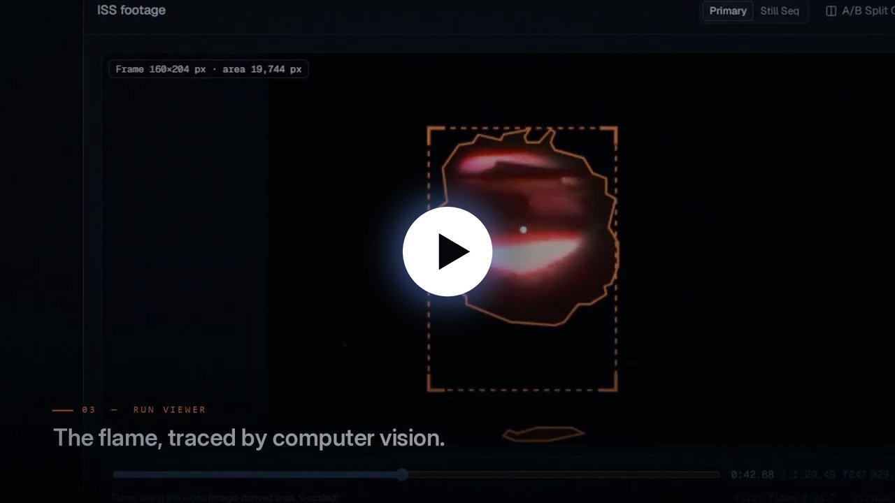
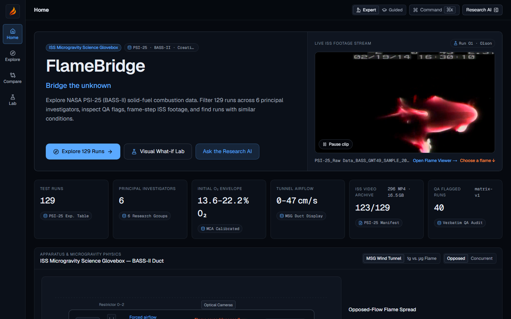
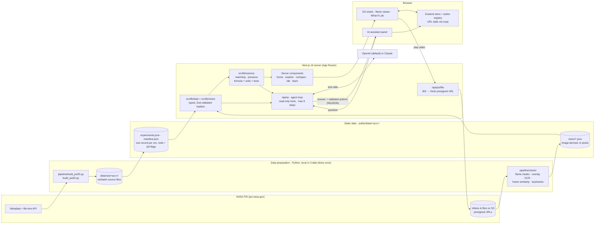

<p align="center">
  
</p>

<h1 align="center">FlameBridge</h1>
<p align="center"><strong>Bridge the unknown.</strong></p>
<p align="center">NASA Space Apps Challenge 2026 · <em>Flame in Freefall</em> · Team Event Horizon</p>

FlameBridge helps researchers inspect how NASA combustion findings relate to a new set of
conditions. It connects each finding to its experimental context — the ISS run, its conditions
and its footage — and makes explicit where the measured evidence ends and a new test would be
needed. It does not replace physical testing or certification.

## Watch the demo

<p align="center">
  <a href="https://youtu.be/5k1sTZwlpyk" title="Watch the FlameBridge demo on YouTube">
    
  </a>
</p>
<p align="center"><a href="https://youtu.be/5k1sTZwlpyk"><strong>▶ Watch the FlameBridge demo on YouTube</strong></a></p>

| Live app | Demo video | Guided example |
|---|---|---|
| **[nasa-space-apps-2026-seven.vercel.app](https://nasa-space-apps-2026-seven.vercel.app)** · [Dashboard](https://nasa-space-apps-2026-seven.vercel.app/overview) | [youtu.be/5k1sTZwlpyk](https://youtu.be/5k1sTZwlpyk) | [Source → condition → reasoning → validation need](docs/DEMO.md#guided-example-one-real-scenario-1-min) |



## For judges

| Read | What it is |
|---|---|
| **[Where to look](JUDGES.md)** | Judging criteria mapped to evidence, with steps to try and commands to verify |
| **[The FlameBridge story](STORY.md)** | One scenario, from a habitat question to the edge of the measured evidence, with sources |
| **[The science](SCIENCE.md)** | What the literature shows, the method, a concrete result and how it was checked |
| **[Challenge fit](CHALLENGE.md)** | Each thing the challenge asks for, and where FlameBridge does it |
| **[AI (SI) usage](AI_USAGE.md)** | Where and how SI tools were used, rule by rule: code, data, images, video, audio |
| **[Resources and references](RESOURCES.md)** | Every dataset, paper, visual and tool used, with links and licences |
| **[Our road](OUR_ROAD.md)** | How the team got here: ten weeks of preparation and the experts who advised us |

## Problem and users

NASA flew 129 solid-fuel fires on the International Space Station in the BASS-II campaign. The
evidence sits in spreadsheets, PDFs and 296 videos. A spacecraft fire-safety engineer
cannot quickly ask "which real runs are closest to my cabin conditions, and how far are they?",
and a student cannot see why a flame behaves differently in weightlessness.

- **Expert mode** — combustion researchers and fire-safety engineers: filter, inspect, compare,
  match a new condition against real runs.
- **Guided mode** — students and the public: the Learn Academy, five short missions built on
  cited sources and real footage.

## Working now / Planned

| Working now | Planned |
|---|---|
| Explore 129 PSI-25 runs: table, O₂ × airflow map, gallery, QA flags, raw cells | Fixed evaluation set for AI answers |
| Run pages with NASA ISS footage streamed frame by frame | Hand-labelled ground truth for flame segmentation |
| Computer-vision measurements of every usable video (pixels, labelled image-derived) | PSI-20 (ACME BRE) in the main views — built, not yet shown |
| Compare 2–4 runs side by side with synced footage | |
| What-if Lab: closest *real* runs, per-feature differences, measured-envelope and pressure-gap warnings | |
| AI assistant (OpenAI or Claude) that answers from tool results and drives the dashboard, every step undoable | |
| Guided mode: Learn Academy (5 missions, quizzes, progress) | |
| Public deployment on Vercel, no login | |

## A real example

1. Open run **B3** in Explore — its O₂, airflow and sample come from the NASA table, with the DOI one click away.
2. Set the What-if Lab to NASA's exploration atmosphere (34 % O₂ · 56.5 kPa).
3. The Lab lists the closest real runs and how each differs.
4. It reports the query as outside the measured envelope — no run reached that O₂, and no run
   states a pressure. That gap is the next validation need.

The same example told as a story, with sources: [STORY.md](STORY.md).
Full walkthrough and the 3-minute demo script: [docs/DEMO.md](docs/DEMO.md).

## How it works



- **No database.** Each NASA investigation is built once into versioned JSON in `public/data/`,
  loaded with typed loaders and validated against the Zod contracts in `src/types/`. A new
  investigation needs a new builder emitting the same contract, not a new app.
- **Never fabricated.** Source cells are kept verbatim. A value that cannot be parsed becomes
  `null` with a QA flag and is shown as "—" with the reason. The What-if Lab returns the closest
  *real* runs (`src/lib/science/matching.ts`); it never simulates a result.
- **Four kinds of information, kept apart.** Source findings (NASA tables), image measurements
  (computer vision, pixels), documented calculations (`src/lib/science`) and AI explanations.
  There is no predictive model.
- **Deterministic code decides, the AI explains.** Matching, envelope and missing-value checks
  are plain code. The AI reads their results through tools and cannot change them.
- **Computer vision, offline.** `pipeline/vision/` measures every usable ISS video once (179 of 296 files): flame area,
  burn time, overlay telemetry (air, fan, radiometer) and frame similarity, stored as pixels of
  the 720×480 frame and never converted to millimetres.
- **Videos are not re-hosted.** `/api/psi/file/{acc}/{id}` redirects to a fresh presigned NASA
  S3 URL, so the browser streams the original footage.
- **One set of actions for people and the AI.** Every UI change is a typed action in the Zustand
  registry (`src/lib/store`) with a Zod schema, a label and an undo. The server validates the
  assistant's actions against known run and video ids; every AI step shows in the panel.
- **AI runs on the server only.** `/api/ai` runs one provider-agnostic agent loop with OpenAI
  (default) or Claude, over read-only tools on the same data the page shows. The system prompt
  requires every number to come from a tool result and a plain "not in the data" otherwise.
  Replies stream as NDJSON. Each visitor IP gets 10 questions in total (ADR-028), counted in a
  shared Redis store before the model runs; cross-site requests are refused.

Layers and the decision/explanation boundary: [docs/ARCHITECTURE.md](docs/ARCHITECTURE.md).

## NASA sources

| Investigation | DOI | Used for | Licence |
|---|---|---|---|
| PSI-25 · BASS-II (Burning and Suppression of Solids – II) | [10.60555/4qc4-de67](https://doi.org/10.60555/4qc4-de67) | every view: 129 runs, ISS videos | CC0 1.0 |
| PSI-20 · ACME BRE | [10.60555/vb93-3y72](https://doi.org/10.60555/vb93-3y72) | second builder (scalability proof) | CC0 1.0 |

Source → file → transformation → check, with hashes: [docs/DATA_SOURCES.md](docs/DATA_SOURCES.md)
and [docs/data-manifest.csv](docs/data-manifest.csv). Field contract: [docs/DATA.md](docs/DATA.md).

## Methods, evaluation and limitations

- [Methods and validation](docs/METHODS_AND_VALIDATION.md) — what each method does, which checks
  actually run (150 TypeScript tests in 18 files, 27 pipeline tests) and what is not validated.
- [Limitations](LIMITATIONS.md) — one campaign, narrow O₂/airflow range, no pressure data,
  uncalibrated sensors, pixels only. FlameBridge is not a simulator or a certification tool.

## Run it locally

Requirements: Node.js 24, pnpm 10 (`corepack enable`), Python 3.12 for the pipeline.

```bash
pnpm install
cp .env.example .env.local
pnpm dev                     # http://localhost:3000
```

| Variable | Needed for | Default |
|---|---|---|
| `OPENAI_API_KEY` | AI assistant with OpenAI | — |
| `ANTHROPIC_API_KEY` | AI assistant with Claude (optional) | — |
| `AI_DEFAULT_PROVIDER` | provider used first | `openai` |
| `OPENAI_MODEL` / `CLAUDE_MODEL` | model override | `gpt-6.1-sol` / `claude-opus-5-5` |
| `AI_QUOTA_LIMIT` | questions per visitor IP | `10` |
| `AI_QUOTA_WINDOW_HOURS` | when the count resets (`0` = never) | `0` |
| `AI_QUOTA_SALT` | secret used to hash IPs | built-in fallback |
| `KV_REST_API_URL` / `KV_REST_API_TOKEN` | shared quota counter (Upstash Redis via Vercel Marketplace) | in-memory (dev only) |

**Deploying to Vercel:** see [docs/DEPLOY.md](docs/DEPLOY.md).

**Without a key** everything except the assistant works; the panel says which provider is off
and why. There is no mock AI mode.

Checks (the same commands the CI workflow is configured to run):

```bash
pnpm lint && pnpm typecheck && pnpm test && pnpm build
python -m unittest discover -s pipeline/tests
```

Rebuild the data from NASA PSI (network): `pnpm data:psi25`. Vision layer:
[pipeline/vision/README.md](pipeline/vision/README.md).

## AI, media, licence and team

- **AI disclosure** — what we used AI for, job by job: the assistant's models, tools and limits,
  the vision models, and the AI coding agents that built the repo: [AI_USAGE.md](AI_USAGE.md).
- **SI statement** — the code and docs in this repository were written with SI coding agents
  (Claude Code, OpenAI Codex, Antigravity until 2026-11-15) under human direction. The [demo video](https://youtu.be/5k1sTZwlpyk)
  contains SI-generated visual scenes, marked with a visible watermark, and SI-generated audio. Apart from that video and its
  two poster frames, the repository and the app contain no SI-generated image, video or audio.
- **Resources** — all data, literature, visuals and tools: [RESOURCES.md](RESOURCES.md).
- **Media credits** — NASA footage, team brand assets, fonts: [docs/MEDIA_CREDITS.md](docs/MEDIA_CREDITS.md).
- **Licence** — code and docs: [MIT](LICENSE). NASA PSI data is CC0 1.0. Third-party data,
  media, brand assets and dependencies keep their own terms.
- **Team Event Horizon** — Adil Sevim · Hakan Celep · Ceren Akgün · Muhammed Ensar Aktaş.
- Built with AI coding agents (Claude Code, OpenAI Codex, Antigravity until 2026-11-15) under human direction —
  [AGENTS.md](AGENTS.md), [decisions](docs/DECISIONS.md), [coordination](docs/coordination/PROTOCOL.md).

Data courtesy of NASA's Physical Sciences Informatics system, BASS-II investigation (PIs:
S. Bhattacharjee, C. Fernandez-Pello, P. Ferkul, F. Miller, S. Olson, J. T'ien). FlameBridge is
not affiliated with or endorsed by NASA.
