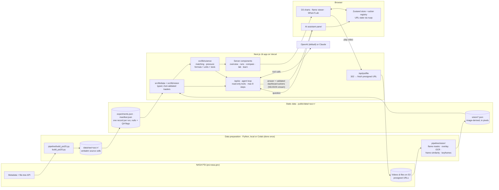

# Fire in Freefall

**An AI-powered interactive research dashboard for NASA microgravity combustion data** —
NASA Space Apps Challenge 2026 · *Fire in Freefall*.

Explore 129 real solid-fuel burns flown on the International Space Station (PSI-25 · BASS-II):
filter by oxygen and airflow, watch the original ISS footage frame by frame, compare runs, ask
"what if?" and get the closest *real* experiment — never a fabricated one — and let an AI research
assistant drive the whole dashboard for you.

| | |
|---|---|
| Data | NASA Physical Sciences Informatics — PSI-25 BASS-II (DOI 10.60555/4qc4-de67, CC0) |
| Stack | Next.js 16 · React 19 · TypeScript · Tailwind v4 · D3 · Zustand · OpenAI + Claude (switchable) · Python pipeline |
| Deploy | Vercel, no login |

## How it works



- **No database.** Each NASA investigation is built once into versioned JSON in `public/data/`.
  The app loads it with typed loaders and validates it against the Zod contracts in `src/types/`.
  A new investigation needs a new builder emitting the same contract, not a new app.
- **Never fabricated.** Source cells are kept verbatim. A value that cannot be parsed becomes
  `null` with a QA flag, and the UI shows it as "—" with the reason. The What-if Lab returns the
  closest *real* runs (`src/lib/science/matching.ts`). It never simulates a result.
- **Computer vision, offline.** `pipeline/vision/` measures every ISS video once: flame area,
  burn time, overlay telemetry (air, fan, radiometer) and frame similarity. Results are stored as
  pixels of the 720×480 frame and labelled image-derived. They are never converted to millimetres.
- **Videos are not re-hosted.** `/api/psi/file/{acc}/{id}` redirects to a fresh presigned NASA S3
  URL (CORS `*`, byte ranges), so the browser streams the original footage frame by frame.
- **One set of actions for people and the AI.** Every UI change is a typed action in the Zustand
  registry (`src/lib/store`). Each action has a Zod schema, a label and an undo. The assistant
  dispatches the same actions, which the server validates against known run and video ids. Every
  AI step shows up in the panel and can be undone.
- **AI runs on the server only.** `/api/ai` runs a provider-agnostic agent loop with OpenAI
  (default) or Claude. Its tools are read-only over the same data the page shows. The system
  prompt requires every number to come from a tool result, and the assistant must say so plainly
  when the data does not hold the answer. Replies stream as NDJSON events and are rate-limited per
  client.

## Quick start

```bash
pnpm install
cp .env.example .env.local      # add OPENAI_API_KEY (ANTHROPIC_API_KEY optional)
pnpm dev                        # http://localhost:3000
pnpm data:psi25                 # optional: rebuild data from NASA PSI
```

## Team — Event Horizon
Adil Sevim · Hakan Celep · Ceren Akgün · Muhammed Ensar Aktaş

## Documentation
- [Product spec](docs/PRODUCT.md) · [Architecture](docs/ARCHITECTURE.md) ·
  [Design system](docs/DESIGN_SYSTEM.md) · [Data](docs/DATA.md) · [Decisions](docs/DECISIONS.md)
- Built by a coordinated team of AI engineers (Claude Code, Codex, Antigravity) under human
  direction — see [AGENTS.md](AGENTS.md) and [docs/coordination/](docs/coordination/PROTOCOL.md).

## Data credit
Data courtesy of NASA's Physical Sciences Informatics system, BASS-II investigation
(PIs: S. Bhattacharjee, C. Fernandez-Pello, P. Ferkul, F. Miller, S. Olson, J. T'ien).
